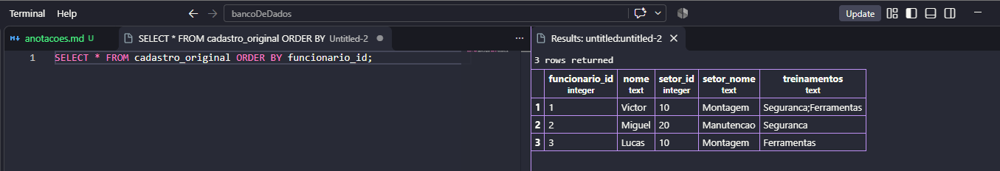
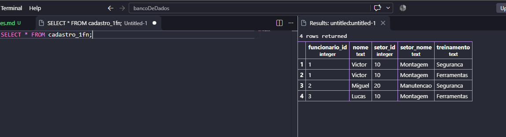
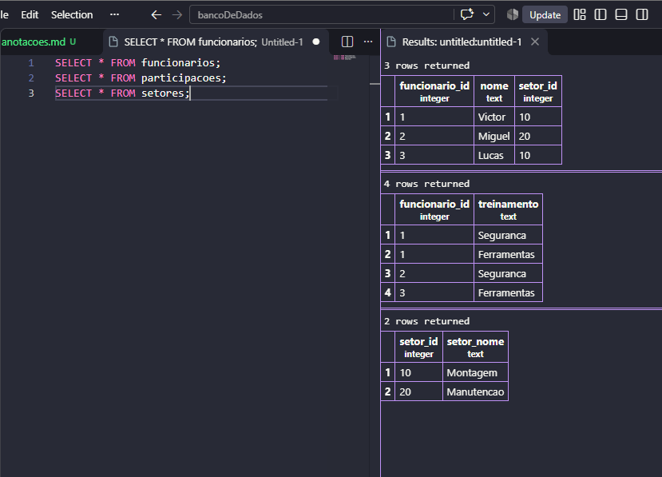

# Normalização de Banco de dados

>Objetivo: Normalizar um banco de dados com probelmas de organização de registros.

1. Primeiro, criar o banco de dados:
```sql
CREATE DATABASE empresa_pietro;
```

2. Criação da tabela original
```sql
CREATE TABLE cadastro_original (
    funcionario_id INTEGER PRIMARY KEY,
    nome TEXT,
    setor_id INTEGER,
    setor_nome TEXT,
    treinamentos TEXT
);
```

3. insetimos os dados na tabela:
```sql 
INSERT INTO cadastro_original VALUES 
(1, 'Victor',10,'Montagem','Seguranca;Ferramentas'),
(2, 'Miguel',20,'Manutencao','Segurança'),
(3, 'Lucas',10,'Montagem','Ferramentas');
``` 

4. Ao realizar a primeira consulta, verificamos que o Victor esta com dois registros na mesma linha!!
```sql
SELECT * FROM cadastro_original ORDER BY funcionario_id
```


**Oque iremos fazer agora se chama 1fn (primeira forma normal)**

5. Criamos uma nova tabela tratada:
```sql
CREATE TABLE cadastro_1fn AS
SELECT funcionario_id, nome, setor_id, setor_nome,
    string_to_table(treinamentos, ';') AS treinamento
FROM cadastro_original
```
6. alterar os valor da tabela
```sql
ALTER TABLE cadastro_1fn
ADD PRIMARY KEY ()
```


### 2FN
1. Criação da tabela de funcionarios
```sql
CREATE TABLE funcionarios AS 
SELECT DISTINCT funcionario_id,nome,setor_id,setor_nome
FROM cadastro_1fn;
```
> O DISTINCT evita copiar valores iguais mais de uma vez, ou seja os treinamentos viram um so

2. O comando CREATE TABLE AS não traz as chaves primarias automaticamente, dessa forma, executamos o comando: 
```sql
ALTER TABLE funcionarios
ADD PRIMARY KEY (funcionario_id);
```

3. Criamos a tabela PARTICIPACOES, trazendo apenas o Id do funcionario e seus treinamentos
```sql
CREATE TABLE participacoes AS SELECT funcionario_id,treinamento FROM cadastro_1fn;
```

4. Adicionando as chaves primarias:
```sql
ALTER TABLE participacoes
ADD PRIMARY KEY (funcionario_id,treinamento);
```

5. Adicionando a chave estrangeira (relações entre tabelas):
```sql
ALTER TABLE participacoes 
ADD FOREIGN KEY (funcionario_id) REFERENCES funcionarios(funcionario_id);
```

6. Verificando a 2FN:
```sql
SELECT * FROM funcionarios;

SELECT * FROM participacoes
```


--- 
### 3FN
1. Criação da tabela de setores:
```sql
CREATE TABLE setores AS SELECT DISTINCT setor_id, setor_nome FROM funcionarios;
```

2. add a chave primaria:
```sql
ALTER TABLE setores
ADD PRIMARY KEY (setor_id);
```

3. Criando a chave estrangeira:
```sql
ALTER TABLE funcionarios
ADD FOREIGN KEY (setor_id) REFERENCES setores(setor_id);
```

4. Correção do erro na hora de criar a tabela:
```sql
ABLE funciALTER Tonarios 
ALTER COLUMN setor_id SET NOT NULL;
```

5-apagamos a coluna setor_nome, uma vez que tiramos essa informação da tabela funcionarios 3fn:
```sql
ALTER TABLE funcionarios
DROP COLUMN setor_nome;
```

6- fim das tabelas:
