## Empresa Manutec

1- criação do banco de dados:
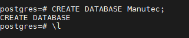

2- criação de tabela:
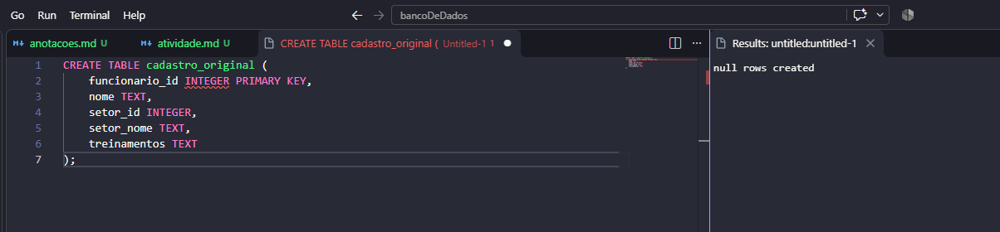

3- adicionado as informações na tabela:
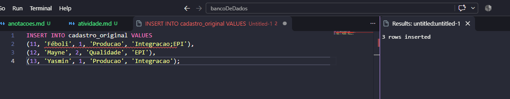

## 1fn:
1- cadastro 1fn:
```sql
CREATE TABLE cadastro_1fn AS SELECT
funcionario_id,
nome,
setor_id,
setor_nome,
treinamentos
FROM cadastro_original
CROSS JOIN LATERAL
    string_to_table(treinamentos, ';') AS t(treinamento);
```

2- executar o comando:
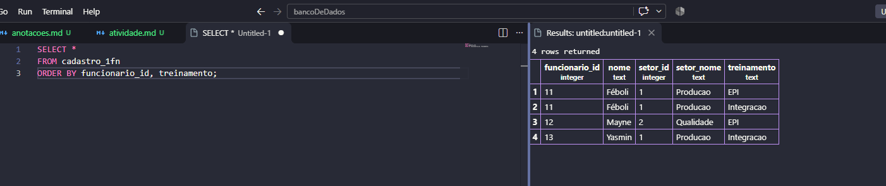

3-adicionar chave prima:
```sql
ALTER TABLE cadastro_1fn
ADD PRIMARY KEY (funcionario_id, treinamentos);
```
4- final da tabela:
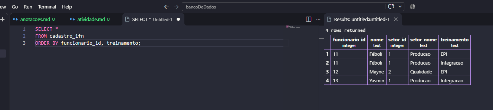

## 2fn:
1- criaação da tabela:
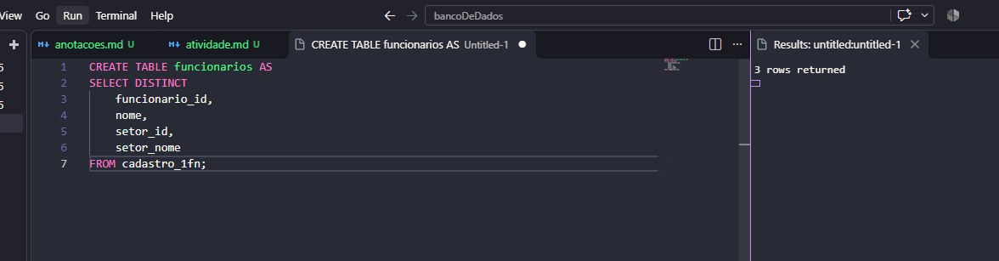

2-chave primaria:
```sql
ALTER TABLE funcionarios
ADD PRIMARY KEY (funcionario_id);
```
3-tabela funcionarios criada:
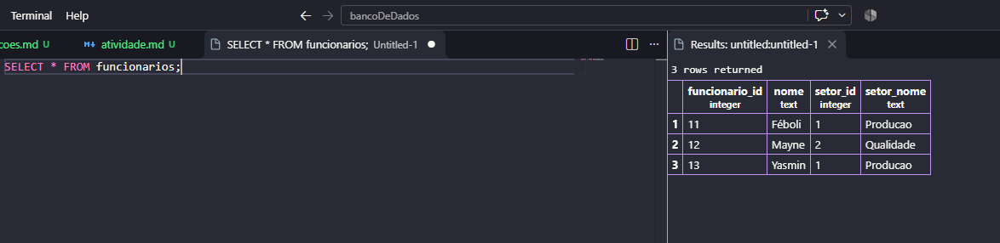

4-criação tabela participacoes:
```sql
CREATE TABLE participacoes AS
SELECT
    funcionario_id,
    treinamento
FROM cadastro_1fn
```

5- conferir:
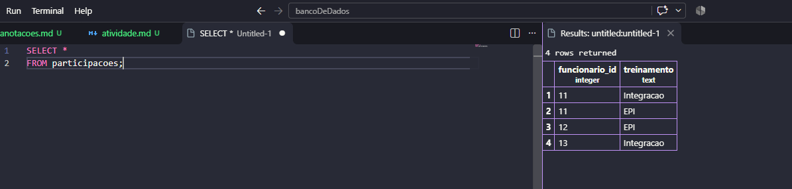

6-executar chave primaria:
```sql
ALTER TABLE participacoes
ADD PRIMARY KEY (funcionario_id, treinamento);
```

7-ligar as tabelas:
```sql
ALTER TABLE participacoes
ADD FOREIGN KEY (funcionario_id)
REFERENCES funcionarios(funcionario_id);
```

8- executar as duas tabelas:
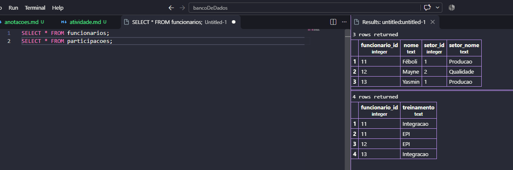

## 3fn:
1-criar a tabela:
```sql
CREATE TABLE setores AS
SELECT DISTINCT
    setor_id,
    setor_nome
FROM funcionarios;
```
2- depois execute:
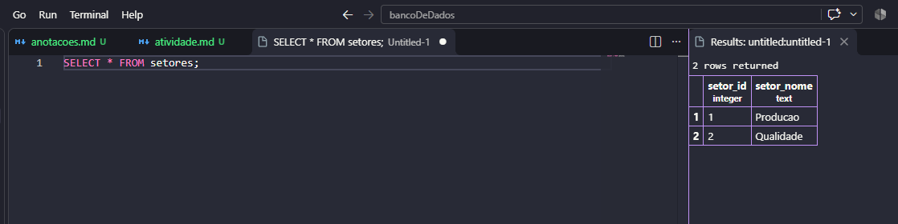

3-definir a chave primaria:
```sql
ALTER TABLE setores
ADD PRIMARY KEY (setor_id);
```
4-relacionar funcionarios aos setores:
```sql
ALTER TABLE funcionarios
ADD FOREIGN KEY (setor_id)
REFERENCES setores(setor_id);
```

5- preenchimento setor_id:
```sql
ALTER TABLE funcionarios
ALTER COLUMN setor_id SET NOT NULL;
```

6- retire a coluna setor_nome:
```sql
ALTER TABLE funcionarios
DROP COLUMN setor_nome;
```

7- fim da atividade completa:
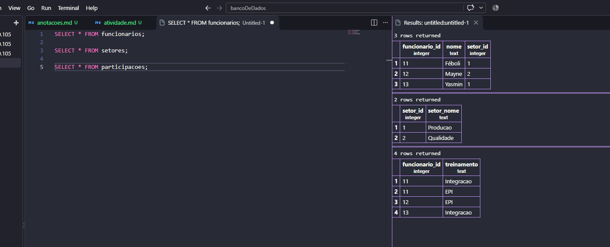